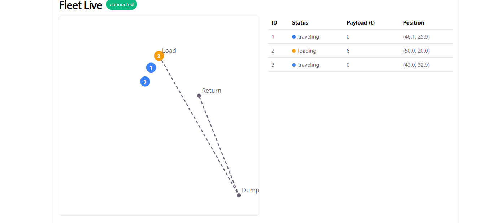
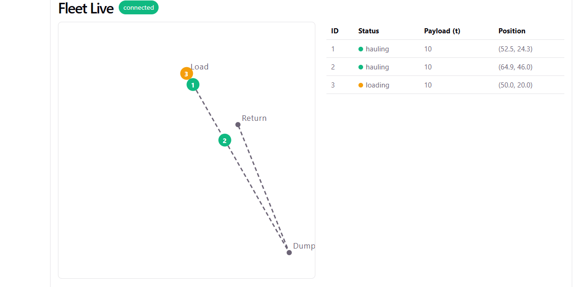
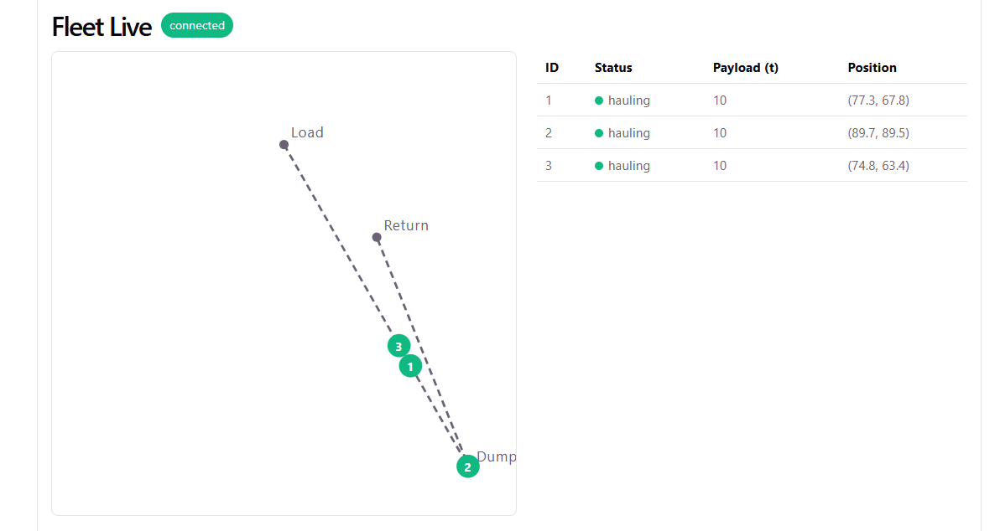
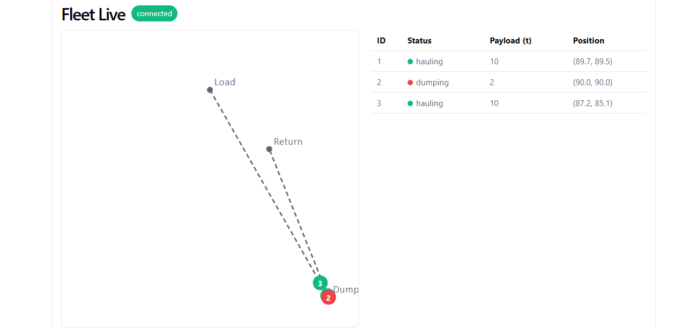
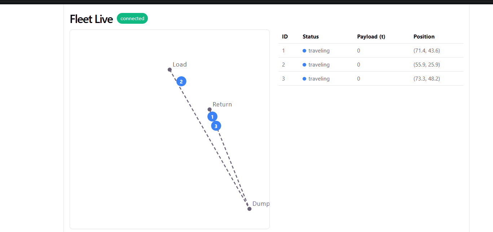

# Fleet Live

Real-time dashboard for a simulated mining haul fleet. A Python simulator moves trucks through a load → haul → dump cycle, and FastAPI streams the fleet state to the browser over a WebSocket every second.



## Tech stack

- **Backend:** Python, FastAPI, Uvicorn, asyncio, WebSockets
- **Frontend:** React 19, TypeScript, Vite
- **Infra:** Redis via Docker Compose (set up for the next steps, not used yet)

## How it works

- **Simulator (Python, asyncio):** each truck runs its own coroutine as a small state machine (traveling → loading → hauling → dumping). Movement uses vector math: the truck moves a fixed step toward its next waypoint each tick. The route is circular, using modulo on the waypoint index.
- **API (FastAPI):** on startup, a `lifespan` handler launches one task per truck plus a broadcast loop. A `ConnectionManager` tracks connected clients and sends the fleet snapshot to all of them every second, removing clients that disconnect.
- **Dashboard (React + TypeScript):** a `useFleet` hook opens the WebSocket, keeps typed state and reconnects automatically. Trucks are drawn on an SVG map, colored by status, next to a status table.

```
┌──────────────────────────────┐                        ┌───────────────────────────┐
│ Backend (FastAPI)            │   WebSocket /ws/fleet  │ Frontend (React + TS)     │
│                              │  ── JSON every 1s ──▶  │                           │
│ simulador.py                 │                        │ useFleet.ts               │
│  └─ one coroutine per truck  │                        │  └─ typed state, reconnect│
│ main.py                      │                        │ App.tsx                   │
│  ├─ lifespan: start tasks    │                        │  ├─ SVG map               │
│  ├─ broadcast_fleet()        │                        │  └─ status table          │
│  └─ ConnectionManager        │                        │                           │
└──────────────────────────────┘                        └───────────────────────────┘
```

### The haul cycle

| Status | Color | What happens |
|---|---|---|
| `traveling` | 🔵 blue | Empty truck driving to the next waypoint |
| `loading` | 🟠 orange | At **Load**, adds 2 t per second until full (10 t) |
| `hauling` | 🟢 green | Loaded, driving to **Dump** |
| `dumping` | 🔴 red | At **Dump**, unloads 2 t per second until empty |

After dumping, the truck drives through **Return** and starts the cycle again.

| Loading | Hauling |
|---|---|
|  |  |
| **Dumping** | **Returning** |
|  |  |

### Movement math

Every tick (1 s), each moving truck:

1. Computes the vector to its target: `dx = target_x - x`, `dy = target_y - y`
2. Gets the distance: `d = sqrt(dx² + dy²)`
3. Normalizes it to a direction: `(dx / d, dy / d)`
4. Moves `speed * dt` (5 units) along it, capped at `d` so it never overshoots the waypoint

Arrival is checked with a tolerance (`d < 0.5`) instead of exact equality, because float coordinates rarely match exactly. Positions live on a 0–100 plane that maps directly onto the SVG `viewBox`.

### State and why there is no Redis yet

All state lives in memory inside the single Uvicorn process:

| What | Where | Holds |
|---|---|---|
| `TRUCKS` | `simulador.py` | The fleet state: position, status, payload and target of each truck |
| `ROUTE` | `simulador.py` | The three waypoints (constant) |
| `manager.connections` | `main.py` | Open WebSocket clients |
| `tasks` | `main.py` (`lifespan`) | One asyncio task per truck plus the broadcast loop |

Each truck coroutine updates its own `Truck` object in place, and `broadcast_fleet()` reads the same objects through `fleet_snapshot()`. Everything runs on one asyncio event loop and only one coroutine runs at a time, switching only at `await`, so no locks are needed.

Redis isn't needed yet because:

- **One process:** the simulator (producer) and the broadcaster (consumer) share the same memory.
- **No persistence needed:** it's a simulation, so resetting the trucks on restart is fine.
- **Small data:** a few trucks updated once per second fit easily in a Python list.

Redis becomes necessary once state has to be **shared across processes** or **survive restarts**: when the simulator becomes its own service, when running several Uvicorn workers (each would have its own `TRUCKS` and its own clients), or when keeping history for alerts.

## Run it

**Requirements:** Python 3.11+, Node.js 20+, Docker (optional, for Redis).

```bash
# backend
cd backend
python -m venv .venv && .venv\Scripts\activate   # Windows
# source .venv/bin/activate                      # Linux/macOS
pip install -r requirements.txt
uvicorn main:app --reload

# frontend (another terminal)
cd frontend
npm install
npm run dev

# redis (optional, not used yet)
docker compose up -d
```

Open http://localhost:5173. The badge next to the title shows `connected` when the WebSocket is live, and `reconnecting` if the backend goes down.

## API

| Method | Route | Description |
|---|---|---|
| `GET` | `/health` | Health check: `{"status": "ok"}` |
| `GET` | `/` | Current fleet snapshot as JSON |
| `WS` | `/ws/fleet` | Streams the fleet snapshot every second |

Example snapshot:

```json
[
  { "id": 1, "x": 52.5, "y": 24.3, "status": "hauling", "payload_tons": 10, "target_index": 1 },
  { "id": 2, "x": 90.0, "y": 90.0, "status": "dumping", "payload_tons": 2, "target_index": 1 },
  { "id": 3, "x": 50.0, "y": 20.0, "status": "loading", "payload_tons": 6, "target_index": 0 }
]
```

## Project structure

```
Fleet-Live/
├── backend/
│   ├── main.py            # FastAPI app, lifespan, WebSocket and broadcast
│   ├── simulador.py       # Truck dataclass, route and state machine
│   └── requirements.txt
├── frontend/src/
│   ├── App.tsx            # SVG map + status table
│   ├── App.css
│   └── useFleet.ts        # WebSocket hook with auto-reconnect
├── docs/screenshots/
└── docker-compose.yml     # Redis
```

## Next steps

- Move the simulator into its own service and stream telemetry with gRPC.
- Use Redis to hold the latest fleet state and Pub/Sub between services.
- Alert when a truck stays stopped for too long.

## How it was built

I wrote the simulator and the WebSocket backend by hand, which is where I focused my time. The React UI was built with AI assistance and reviewed by me.
